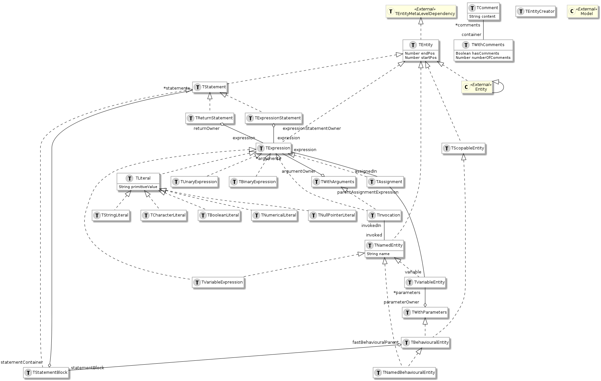

# FAST

[](https://github.com/moosetechnology/FAST/actions/workflows/tests.yml) [](https://github.com/moosetechnology/FAST/actions/workflows/fast-python.yml)

Supported Moose Versions: [](https://github.com/moosetechnology/Moose) [](https://github.com/moosetechnology/Moose)

## Installation

To install FAST execute in a playground:

```st
Metacello new
  githubUser: 'moosetechnology' project: 'FAST' commitish: 'v3' path: 'src';
  baseline: 'FAST';
  load
```

## Importers

FAST imports source files into models with importers, one per language. Quickstart:

```st
"One file, in a new model"
FASTAgnosticImporter parseFile: 'src/Main.java' asFileReference.

"A folder: one model per language, the files without importer under nil"
FASTAgnosticImporter parseFolder: 'src' asFileReference.
```

The full guide, with the options for missing importers and how to write an importer, is in [resources/doc/importers.md](resources/doc/importers.md).

## FAST Meta-Model



